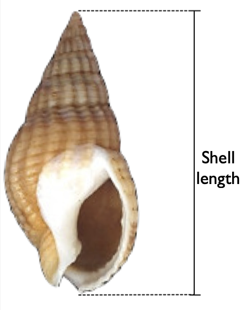
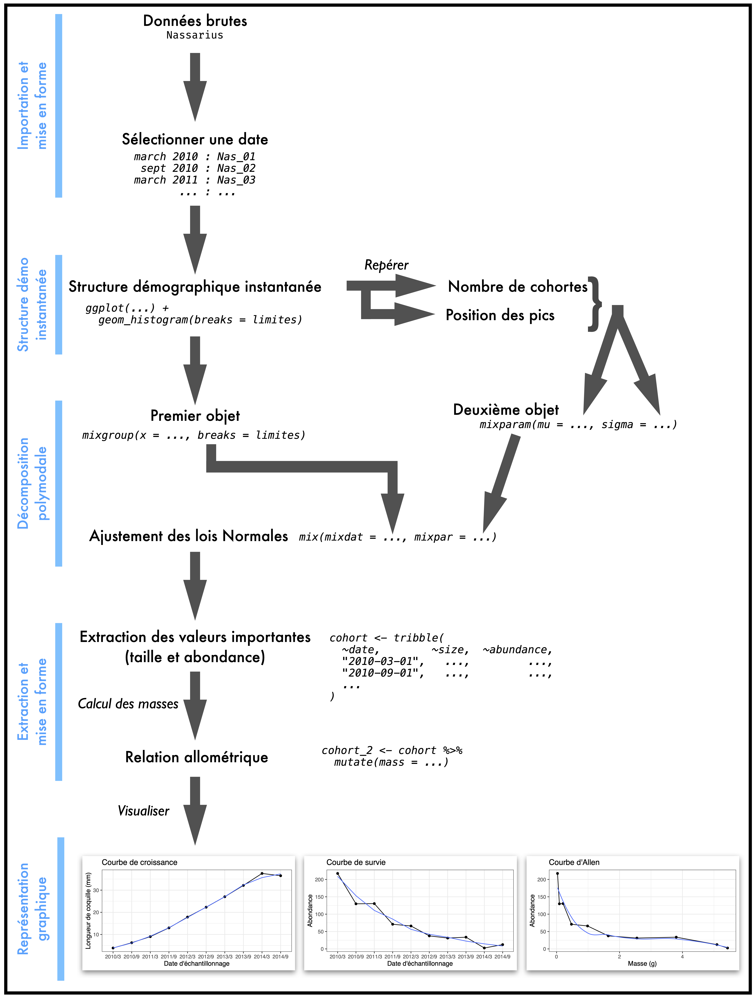

# Analyse de cohortes {#sec-cohortes}

## Objectifs

Cette section doit permettre d'illustrer la partie du cours de Population Dynamics de l'EC "Fonctionnement des écosystèmes" consacrée à l'analyse des cohortes. Vous utiliserez les tailles corporelles d'individus échantillonnés sur le terrain à plusieurs dates pour :

1. Produire la structure démographique instantanée de la population pour chaque date d'échantillonnage
2. Réaliser la décomposition polymodale pour identifier les cohortes à chaque date d'échantillonnage
3. Créer une courbe de croissance et une courbe de mortalité
4. Utiliser une relation allométrique pour passer de la taille des individus à leur masse
5. Produire la courbe d'Allen

Vous devrez en premier lieu importer les données fournies dans un fichier Excel et vous assurer qu'elles sont dans un format permettant les analyses et représentations graphiques.

## Présentation de l'étude {#sec-pres}

Le suivi démographique des populations animales est extrêmement fréquent dans le domaine de l'écologie. Le suivi des populations naturelles est particulièrement pertinent dans un contexte de conservation, pour réaliser des études d'impact ou pour mesurer l'évolution de la biodiversité.

Ici, une population de gastéropodes *Nassarius reticulatus* (la nasse réticulée) a été suivie pendant 5 ans. Deux sessions d'échantillonnage ont été organisées chaque année depuis 2010 : la première a été réalisée en mars, juste après le recrutement des juvéniles, et la seconde a été réalisée 6 mois plus tard, en septembre. Tous les échantillons ont été collectés au même endroit, selon la même méthode (collecte systématique de tous les individus présents à l'intérieur de 10 quadrats positionnés aléatoirement dans la zone d'étude), lors d'une marée basse de fort coefficient (marées de printemps et d'automne). Les individus échantillonnés ont été mesurés sur place, de la base, à l'apex de la coquille (voir @fig-nasse) à l'aide d'un pied à coulisse (précision : centième de millimètre) et relâchés sur place.


::: {.column-margin}
{#fig-nasse}
:::


L'espèce étudiée présente les caractéristiques suivantes :

- Les individus ont une durée de vie de 5 ans en moyenne.
- Les plus grands individus peuvent atteindre une taille de plus de 40 millimètres.
- Il n'y a qu'une seule période de reproduction chaque année. Il n'y a donc qu'un unique recrutement chaque année, au tout début du mois de mars.

Des travaux antérieurs, réalisés au laboratoire, ont montré que la taille et la masse des individus étaient liées par la relation allométrique suivante :

$$w = 0,0013 \cdot l^{2,3}$$

avec $w$, la masse en grammes et $l$ la longueur des coquilles en millimètres.


:::{.callout-important}
## Objectif principal

L'objectif principal de cette étude est de produire la courbe d'Allen d'une cohorte de cette population. Cette courbe sera utilisée pour déterminer des gains et des pertes de biomasses au sein de l'écosystème étudié. Les étapes nécessaires à la production de cette courbe sont présentées ci-dessous.
:::

## Avant de vous lancer...

Pour travailler dans de bonnes conditions, vous aurez absolument besoin de travailler dans un script et à l'intérieur d'un `Rproject`. Si vous ne savez plus comment faire, reportez-vous aux chapitres correspondants du livre en ligne de Biométrie du semestre 3 : [au sujet des scripts](https://besibo.github.io/BiometrieS3/01-R-basics.html#sec-script) et [au sujet des `Rprojects`](https://besibo.github.io/BiometrieS3/01-R-basics.html#les-projets-ou-rprojects). Vous devrez notamment (liste non exhaustive !) :

1. Créer un nouveau script (nommez-le `Nasses.R`)
1. Télécharger (si besoin) et charger quelques packages (voir plus bas)
1. Télécharger dans votre répertoire de travail le fichier <a href="data/Nassarius.csv" download>Nassarius.csv</a>
1. Importer dans `RStudio` les données du fichier `Nassarius.csv`

Pour cette section, vous aurez besoin des packages suivants :

- `tidyverse` : pour manipuler les données et faire des graphiques [@tidyverse2019]
- `mixdist` : pour effectuer les décompositions polymodales [@R-mixdist]

Si vous ne savez plus comment installer et charger des packages en mémoire, reportez-vous au chapitre correspondant du [livre en ligne de Biométrie du semestre 3](https://besibo.github.io/BiometrieS3/01-R-basics.html#sec-packages)

```{r}
#| message: false
#| warning: false

library(tidyverse)
library(mixdist)
```

Pour importer les données, utilisez l'assistant d'importation de `RStudio`. Notez que :

- Les colonnes sont séparées par des tabulations
- Le symbole utilisé pour les décimales dans le fichier `Nassarius.csv` est la virgule

Vous devrez donc spécifier correctement ces éléments pour pouvoir importer le fichier dans le logiciel. Si vous ne savez plus comment faire, reportez-vous au chapitre correspondant du [livre en ligne de Biométrie du semestre 3](https://besibo.github.io/BiometrieS3/04-DataWrangling.html#plaintext).

```{r}
#| include: false

Nassarius <- readr::read_csv("Data/Nassarius.csv")
```

Si l'importation s'est déroulée normalement, vous devriez maintenant disposer de l'objet nommé `Nassarius` suivant :

```{r}
Nassarius
```

Et la commande suivante devrait produire exactement ces résultats :

```{r}
Nassarius |>
  count(date)
```

:::{.column-margin}
`|>` : le pipe est un opérateur spécial qui prend l'objet situé à gauche et le transmet à la fonction placée à droite, en guise de premier argument. P. ex. : `Nassarius |> count(date)` est équivalent à `count(Nassarius, date)`  
<br>
`count()` : compte le nombre d'occurrences de chaque valeur possible (ou niveau/modalité) d'une variable catégorielle (ou facteur).
:::


## Les étapes de l'analyse

Pour produire une courbe d'Allen, de nombreuses étapes sont nécessaires. Vous devrez : 

1. Produire la *structure démographique instantanée* de la population à chaque date d'échantillonnage
1. Réaliser la *décomposition polymodale* pour identifier les cohortes présentes dans la population à chaque date d'échantillonnage. 
1. Déterminer la taille moyenne de la coquille des individus de la cohorte d'intérêt, à chaque date d'échantillonnage, pour produire la *courbe de croissance*
1. Déterminer l'abondance des individus de la cohorte d'intérêt, à chaque date d'échantillonnage, pour produire la *courbe de survie*

Je vais présenter ci-dessous les étapes de cette procédure **pour une unique date d'échantillonnage** : march 2010. Vous devrez reproduire ces étapes pour les 9 autres dates d'échantillonnage.


## Sélection des données d'une date spécifique

Notre jeu de données `Nassarius` contient 2 colonnes : la première contient les dates d'échantillonnage et la seconde les tailles individuelles en millimètres. La première étape consiste à créer un nouvel objet (nous le nommerons `Nas_01`) qui contiendra uniquement les données collectées lors de la toute première session d'échantillonnage de mars 2010. Vous devriez déjà savoir comment utiliser la fonction `filter()` pour le faire :

```{r}
Nas_01 <- Nassarius |>
  filter(date == "2010-03")

Nas_01
```

:::{.column-margin}
`filter()` : permet de filtrer les lignes d'un tableau (ici `Nassarius`) pour ne conserver que celles qui remplissent une condition spécifiée par l'utilisateur (ici `date == "march_10"`)
:::

```{r}
dim(Nassarius)
dim(Nas_01)
```

:::{.column-margin}
`dim()` : Affiche le nombre de lignes et de colonnes d'un tableau.
:::

Comme nous pouvons le constater, on passe du tableau original `Nassarius` contenant `r nrow(Nassarius)` lignes à un nouveau tableau `Nas_01` qui en contient seulement `r nrow(Nas_01)`.

## Structure démographique instantanée

Maintenant que nous disposons d'une table `Nas_01` qui contient uniquement la taille des individus collectés en mars 2010, il nous faut visualiser la structure démographique instantanée afin de déterminer combien de cohortes étaient présentes dans la population à cette date. La structure démographique instantanée est ici simplement un histogramme présentant la distribution des tailles individuelles. Nous allons donc placer la taille des individus sur l'axe des `x` en guise de descripteur individuel, et sur l'axe des `y`, `RStudio` placera automatiquement l'abondance pour chaque classe de taille en guise de descripteur populationnel.

```{r}
#| label: fig-histo1
#| fig-cap: "Structure démographique instantanée"
#| cap-location: margin

Nas_01 |>
  ggplot(aes(x = size)) +
  geom_histogram()
```

:::{.column-margin}
`ggplot()` : crée un graphique  
<br>
`aes()` : associe une variable d'un jeu de données à une caractéristique esthétique d'un graphique (p. ex. la position le long de l'axe des `x` ou des `y`, la couleur, la forme, la taille, etc.)  
<br>
`geom_histogram()` : ajoute un objet géométrique de type histogramme à un graphique produit par `ggplot()`
:::

Notez le message d'avertissement qui s'affiche quand vous produisez cet histogramme. Il indique que `R` a choisi pour nous le nombre de classes de tailles. Par défaut, il crée 30 classes, mais nous indique que ce n'est certainement pas le meilleur choix. Nous allons donc devoir créer nous-mêmes manuellement les classes de tailles pour (i) identifier les cohortes présentes dans la population et (ii) fixer des classes identiques que nous utiliserons pour toutes les autres dates d'échantillonnage et qui rendront les comparaisons plus aisées.

Puisque les individus de cette espèce peuvent atteindre une taille de 40 millimètres environ, nous allons définir des classes de tailles tous les millimètres. On peut faire ça simplement en créant un vecteur qui contient les limites des classes de tailles que l'on souhaite :

```{r}
# Calcul de la taille maximale observée
taille_max <- max(Nassarius$size, na.rm = TRUE)
taille_max
```

:::{.column-margin}
`max()` : affiche la valeur maximale contenue dans un vecteur
:::

```{r}
# Définition des limites des classes de tailles
limites <- 0:(taille_max + 1)
limites
```

:::{.column-margin}
`:` : l'opérateur "deux points" permet de créer des suites d'entiers  
:::

L'objet `limites` contient les limites des classes de tailles que nous utiliserons pour produire les structures démographiques instantanées, pour chaque date d'échantillonnage, et pas seulement pour mars 2010. C'est la raison pour laquelle nous avons utilisé `max(Nassarius$size) +1` : cette syntaxe nous assure que nos classes de tailles recouvrent bien la taille de tous les individus échantillonnés au cours des 5 années d'études. Ainsi, nous pourrons utiliser les mêmes classes de tailles pour toutes les dates.

Maintenant, on peut utiliser le vecteur `limites` comme argument de la fonction `geom_histogram()`. On modifie aussi les couleurs des barres de l'histogramme pour mieux visualiser les classes : 
```{r}
#| label: fig-histo2
#| fig-cap: Structure démographique instantanée utilisable pour la décomposition polymodale
#| cap-location: margin

Nas_01 |>
  ggplot(aes(x = size)) +
  geom_histogram(breaks = limites, color = "black", fill = "steelblue")
```

Cette structure démographique instantanée (@fig-histo2) fait apparaître 5 cohortes, bien que la plus âgée soit à peine visible. Les pics, ou modes, sont situés autour de 4, 9, 17, 30 et 34 millimètres. Ces valeurs approximatives sont importantes car nous les utiliserons pour réaliser la décomposition polymodale.

## Décomposition polymodale 

### Principe et étapes

Effectuer une décomposition polymodale revient à tenter d'ajuster une distribution Normale à chaque cohorte de la population. Puisque nous avons identifié 5 cohortes dans la population en mars 2010, il nous faut identifier 5 distributions Normales distinctes dont la somme reproduira le plus fidèlement possible la structure démographique instantanée observée. Plusieurs étapes sont requises pour y parvenir.

Nous allons utiliser le package `mixdist`, que vous devez avoir déjà installé et chargé en mémoire. Ce package fournit plusieurs fonctions relativement simples d'utilisation et qui permettent d'ajuster des distributions Normales à une distribution observée (notre structure démographique instantanée).

La fonction du package `mixdist` qui nous permettra de réaliser la décomposition polymodale est la fonction `mix()`. Son fichier d'aide nous indique que pour fonctionner correctement, il faut lui fournir plusieurs choses :

```{r}
#| eval: false
?mix()
```

:::{.column-margin}
`?` : l'opérateur "point d'interrogation" suivi du nom d'une fonction, permet d'ouvrir le fichier d'aide de cette fonction.
:::

Les deux premiers arguments de la fonction `mix()` ne possèdent pas de valeur par défaut. Nous devons donc spécifier nous-mêmes ces deux arguments :

1. Le premier s'appelle `mixdat`. Il doit obligatoirement s'agir d'un tableau de données (`data.frame` ou `tibble`) contenant 2 colonnes. La première colonne doit contenir les limites supérieures des classes de tailles de notre structure démographique instantanée. Le dernier élément de cette colonne doit être "ouvert" : il doit être fixé à $+\infty$. La seconde colonne doit contenir les abondances pour chaque classe de taille de la structure démographique instantanée. Nous allons voir juste après comment créer cet objet `mixdat`.
2. Le second argument s'appelle `mixpar`. Là encore, il s'agit d'un tableau de données. Il doit contenir des valeurs approchées pour les paramètres des distributions Normales que nous souhaitons ajuster à chacune de nos 5 cohortes. Chaque distribution Normale possède 2 paramètres : la moyenne (qui correspond à la position du pic sur l'axe des `x` d'un histogramme) et l'écart-type (qui correspond à l'étalement de la courbe en cloche, c'est-à-dire à la dispersion des données de part et d'autre de la moyenne). Là encore, nous verrons plus bas comment créer cet objet.

### Création du premier objet

Pour créer le premier tableau qui sera utilisé comme argument `mixdat` de la fonction `mix()`, nous allons nous servir de la fonction `mixgroup()` du package `mixdist`. Elle est très simple à utiliser puisqu'elle n'a besoin que de 2 arguments :

1. Un vecteur de données (ici, la taille de tous les individus échantillonnés en mars 2010)
2. La liste des valeurs correspondant aux limites des classes de tailles de la structure démographique instantanée. Nous disposons déjà de cet objet puisque nous l'avons créé plus tôt : c'est le vecteur `limites`

```{r}
mix_01 <- mixgroup(Nas_01$size, breaks = limites)
class(mix_01)
```

L'objet `mix_01` que nous venons de créer est donc un `data.frame`, mais c'est aussi un objet de classe `mixdata` que nous utiliserons en guise de premier argument de la fonction `mix()`. Pour afficher son contenu, il suffit comme toujours de taper son nom :

```{r}
mix_01
```

Notez que la dernière ligne de `mix_01` correspond à la catégorie [42 mm ; $+\infty$[. Pour vérifier que nous n'avons pas fait d'erreur, on peut faire une représentation graphique de cet objet particulier avec la fonction `plot()` :

```{r echo=2}
#| label: fig-mixplot
#| fig-cap: "Le contenu de `mix_01` correspond exactement à la structure démographique instantanée de mars 2010. La ligne bleue est le contour de la structure démographique instantanée, qui devra être approchée par la superposition de 5 courbes Normales correspondant aux 5 cohortes qui composent la population en mars 2010"
#| cap-location: margin

par(mar = c(4, 4, 0.4, 0.1))
plot(mix_01, xlab = "Size (mm)", ylab = "Probability")
```

:::{.column-margin}
`plot()` : fonction générique permettant de produire des graphiques sans `ggplot2`. La forme du résultat dépendra de la classe de l'objet utilisé comme argument.  
:::

Au final, l'objet `mix_01` est simplement la structure démographique instantanée de mars 2010, présentée dans un format qui sera compris par la fonction `mix()` que nous utiliserons pour effectuer la décomposition polymodale.


### Création du deuxième objet

Pour créer le second `data.frame()` dont la fonction `mix()` aura besoin, nous allons utiliser une autre fonction du package `mixdist` : la fonction `mixparam()`. Cette fonction prend au minimum 2 arguments :

1. `mu` : un vecteur qui contient la position approximative des modes (ou pics) de chaque cohorte. Si nous avons 5 cohortes à identifier, il faudra fournir 5 valeurs pour `mu`. Pour mars 2010, nous utiliserons les valeurs présentées plus haut, au niveau de la @fig-histo2 (4, 9, 17, 30 et 34 millimètres). Ces valeurs changeront pour chaque date d'échantillonnage et il faudra donc examiner attentivement les structures démographiques instantanées de chaque échantillonnage pour les déterminer. J'insiste sur le fait que la position des pics peut être approximative, mais qu'elle ne doit malgré tout pas être trop éloignée des vraies valeurs.
2. `sigma` : un vecteur qui contient la valeur approchée de l'écart-type de chaque cohorte. L'écart-type d'une cohorte correspond à l'étalement des tailles de part et d'autre de la moyenne de la cohorte. C'est ce que nous avons appelé "polymorphisme" dans le cours de dynamique des populations, puisque cet étalement représente des performances de croissance variables pour des individus qui sont tous nés approximativement en même temps. Là encore, il faut fournir autant de valeurs que nous avons de cohortes (soit 5 pour mars 2010). Puisque nous n'avons pas d'idée précise d'ordre de grandeur pour ces écarts-types, nous utiliserons la valeur `1` pour chaque cohorte.

Ainsi, on obtient le second `data.frame` ainsi :

```{r}
param_01 <- mixparam(mu = c(4, 9, 17, 30, 34),
                     sigma = c(1, 1, 1, 1, 1))
param_01
```

:::{.column-margin}
`mixparam()` : fonction qui crée un `data.frame` dans lequel chaque ligne contient les caractéristiques approchées d'une cohorte de la population échantillonnée  
<br>
`c()` : fonction qui permet de créer un vecteur, donc une collection d'éléments qui sont tous du même type (ici, des valeurs numériques).
:::

La première colonne de ce nouveau `data.frame`, nommée `pi`, correspond à la proportion de l'effectif total échantillonné, contenu dans chaque cohorte. Puisque nous n'avons rien spécifié, `mixparam()` suppose que chaque cohorte contient une proportion identique des individus de la population, et fixe donc la proportion à 0.2 (soit 20% de l'abondance totale dans chacune des 5 cohortes supposées). Nous savons pertinemment que ces proportions sont fausses puisqu'en réalité, l'abondance au sein des cohortes décroit avec l'âge des individus en raison de la mortalité. On sait donc que la cohorte la plus jeune sera la plus abondante, et que les cohortes plus âgées seront de moins en moins abondantes. Ces proportions seront estimées automatiquement par la fonction `mix()` lorsque nous réaliserons la décomposition polymodale. Les autres colonnes de `param_01`, qui contiennent les valeurs que nous avons fournies manuellement, seront également ajustées lors de la décomposition polymodale


### Ajustement des lois Normales aux données

Maintenant que nous disposons des deux objets nécessaires, nous pouvons réaliser la décomposition polymodale qui consiste, grâce à la fonction `mix()`, à ajuster une distribution Normale à chaque cohorte supposée de la population échantillonnée.

```{r}
res_01 <- mix(mix_01, param_01)
res_01
```

:::{.column-margin}
`mix()` : réalise la décomposition polymodale. La fonction identifie une combinaison de distributions Normales qui s'ajuste le mieux possible aux données observées compte tenu des données brutes et des caractéristiques approximatives de chaque distribution Normale fournie par l'utilisateur.
:::

La fonction `mix()` peut produire quelques avertissements. Ignorez-les à ce stade : seuls les messages d'erreurs sont problématiques et nous y reviendrons plus tard. L'objet `res_01` contient donc les résultats de la décomposition polymodale. C'est une liste de 3 éléments dont seul le premier nous intéresse.^[Il s'appelle `parameters`, sans majuscule, même si `R` affiche son nom avec une majuscule. Vous pouvez le vérifier en tapant `str(res_01)`.  

`str()` : affiche la **str**ucture interne d'objets complexes.] Il contient les valeurs ajustées pour les 3 paramètres des distributions Normales (`pi`, `mu` et `sigma`) pour chacune des 5 cohortes identifiées en mars 2010.

Ainsi, par exemple, pour l'échantillon de mars 2010, la première ligne du tableau `parameters` contenu dans `res_01` nous apprend les choses suivantes :

```{r}
res_01$parameters
```

- La première cohorte représente `r round(100*res_01$parameters[1,1],2)`% de l'abondance totale de la population
- La taille moyenne des individus composant cette cohorte vaut `r round(res_01$parameters[1,2],1)` millimètres
- L'écart-type (ou polymorphisme de taille) de cette cohorte vaut `r round(res_01$parameters[1,3],1)` millimètres

Les distributions Normales qui ont été ajustées peuvent être visualisées grâce à la fonction `plot()` :

```{r echo=2}
#| label: fig-ajustement
#| fig-cap: "Distribution observée (histogramme bleu) et cohortes ajustées (courbes rouges). Les triangles indiquent la position du mode des cohortes et la courbe verte est la somme de toutes les distributions Normales. Idéalement, cette courbe devrait être étroitement ajustée aux données observées"
#| cap-location: margin

par(mar = c(4, 4, 0.5, 0.1))
plot(res_01)
```

On observe sur la @fig-ajustement et dans l'objet `res_01$parameters` que la qualité de l'ajustement (et donc de la décomposition polymodale) est bonne :

- la courbe verte représente bien les données observées : elle est bien ajustée aux contours de l'histogramme.
- l'abondance des cohortes décroit avec l'âge de la cohorte : `pi` décroit de la cohorte la plus jeune à la cohorte la plus âgée.
- la taille moyenne des individus augmente avec l'âge de la cohorte : `mu` augmente de la cohorte la plus jeune à la cohorte la plus âgée.
- le polymorphisme (ou dispersion des tailles autour de la moyenne) augmente avec l'âge de la cohorte : `sigma` augmente de la cohorte la plus jeune à la cohorte la plus âgée.

:::{.callout-important}
## De l'importance du choix des valeurs initiales

Si nous avions choisi d'autres valeurs approchées lors de la création de l'objet `param_01` avec la fonction `mixparam()`, l'ajustement obtenu aurait pu être différent. La décomposition polymodale n'est pas une science exacte et il est souvent nécessaire de procéder par tâtonnements pour trouver des valeurs satisfaisantes. En particulier, les résultats que nous obtenons dépendent :

- du choix des valeurs pour la fonction `mixparam()`
- du choix des classes de tailles pour la structure démographique instantanée. Ici, nous avons des classes de tailles de un millimètre de large, mais nous aurions pu faire un autre choix (1,5 millimètre de large, ou 2) et nous aurions alors obtenu des résultats différents.

Il est donc important de retenir que les résultats obtenus ne sont pas "justes" ou "faux" en tant que tels et qu'il n'y a pas qu'une seule "bonne réponse". La qualité des résultats obtenus s'apprécie au regard de ce qu'on connait de l'espèce étudiée (traits d'histoire de vie, période de reproduction et de recrutement, nombre de cohortes supposées selon la date, etc.), et de ce qu'on connait du comportement "normal" des cohortes (baisse de l'abondance avec l'âge, augmentation de la taille moyenne avec l'âge, augmentation du polymorphisme avec l'âge).
:::

### Et en cas de message d'erreur ?

Lorsque vous utiliserez la fonction `mix()`, il se peut que des messages d'erreurs et/ou des messages d'avertissement apparaissent. 

<ul class="fa-ul">
<li><span class="fa-li" style="color:CornFlowerBlue"></span> Les messages d'information et les avertissements commencent en général par le mot `Warning` et sont presque toujours sans conséquence. La commande a été comprise par `RStudio` et un résultat a été produit. Dans le cas de la fonction `mix()`, les avertissements indiquent que la solution trouvée (l'ajustement des lois Normales aux cohortes observées) n'est peut-être pas optimale, mais une solution a néanmoins été obtenue.  </li>

<li><span class="fa-li" style="color:Crimson" class="fa-fade"></span> Les messages d'erreurs commencent par `Erreur` ou `Error` et indiquent que la commande n'a pas abouti. Dans le cas de la fonction `mix()`, cela peut être lié à 2 choses :

  1. soit les valeurs choisies pour la fonction `mixparam()` sont trop éloignées de la position des pics réels, et la fonction `mix()` ne parvient donc pas à trouver de solution satisfaisante
  2. soit le nombre de valeurs choisies pour la fonction `mixparam()` n'est pas le bon. Par exemple, s'il y a 5 cohortes et qu'on ne fournit que 4 valeurs pour `mu` et `sigma`, un message d'erreur apparaîtra. De même, s'il y a 4 cohortes et qu'on fournit 5 valeurs pour `mu` et `sigma`, un message d'erreur apparaîtra. Enfin, si on ne fournit pas le même nombre de valeurs pour `mu` et pour `sigma`, un message d'erreur apparaîtra.  </li>
</ul>

Dans les deux cas, vous devez 

1. revenir à votre structure démographique instantanée et l'observer plus attentivement
2. déterminer des valeurs plus appropriées^[ajoutez ou retirez une cohorte si besoin, et choisissez des valeurs plus proches des pics observés] pour la fonction `mixparam()`
3. ré-exécuter le code depuis la création de l'objet `param_01` et jusqu'à la décomposition polymodale avec la fonction `mix()`


## Taille moyenne et abondance des cohortes

À partir des résultats de la décomposition polymodale, nous devons maintenant calculer l'abondance (*i.e.* le nombre d'individus) de chaque cohorte. Nous devrons ensuite stocker dans un nouveau tableau :

1. la date d'échantillonnage (mars 2010)
2. la valeur d'abondance de la cohorte dont on souhaite réaliser le suivi (il s'agit de la cohorte la plus jeune en mars 2010)
3. la taille moyenne des individus de la cohorte dont on souhaite réaliser le suivi^[on sait déjà que cette taille vaut `r round(res_01$parameters[1,2],1)` millimètres en mars 2010.]

L'abondance d'une cohorte est obtenue en multipliant la valeur de `pi` de la cohorte d'intérêt par le nombre total d'individus échantillonnés en mars 2010. En effet, sur la @fig-ajustement, la surface totale comprise entre l'axe des abscisses et la courbe verte vaut 1. Cette surface correspond au nombre total d'individus échantillonnés en mars 2010 :

```{r}
nrow(Nas_01)
```

:::{.column-margin}
`nrow()` : affiche le nombre de lignes d'une matrice ou d'un `data.frame`
:::

Puisque la première cohorte représente `r round(100 * res_01$parameters[1,1],2)`% de l'abondance totale^[c'est ce que nous dit la valeur de `pi` de la première cohorte dans le tableau `res_01$parameters` :], tout ce dont on a besoin pour connaitre l'abondance de la cohorte la plus jeune est :

```{r}
#| column: margin
#| echo: false

knitr::kable(round(res_01$parameters, 4))
```


```{r}
res_01$parameters[1, 1] * nrow(Nas_01)
```

En arrondissant à l'entier le plus proche, on obtient :

```{r}
round(res_01$parameters[1, 1] * nrow(Nas_01), 0)
```

:::{.column-margin}
`round()` : arrondit des valeurs numériques. Le deuxième argument permet d'indiquer le nombre de décimales.
:::

Nous savons donc maintenant que la première cohorte, la plus jeune de la population échantillonnée en mars 2010, a donc une taille moyenne de `r round(res_01$parameters[1,2],2)` millimètres et une abondance de `r round(res_01$parameters[1,1] * nrow(Nas_01))` individus. Nous allons maintenant utiliser ces valeurs pour créer un tableau et placer le premier point des courbes de croissance, de survie et d'Allen.


## Tableau et mise en forme des données

Nous venons de décrire ci-dessus la méthode que vous devrez appliquer pour chaque date d'échantillonnage. En suivant les mêmes étapes, vous devriez être en mesure d'obtenir la taille et l'abondance moyennes de notre cohorte d'intérêt pour les 9 dates restantes. Lorsque vous effectuerez la décomposition polymodale pour ces 9 dates, n'oubliez jamais que vous voulez suivre *systématiquement la même cohorte dans le temps*. Cette cohorte va progressivement évoluer vers des tailles plus importantes puisque les individus grandissent chaque mois et chaque année. Notre cohorte d'intérêt va donc progressivement se décaler vers la droite des structures démographiques instantanées, et les informations de cette cohorte ne seront donc pas systématiquement situées sur la première ligne des résultats de la décomposition polymodale. 

Pour chaque date, on s'attend donc à ce que la taille moyenne des individus soit plus grande que la taille obtenue pour la date d'échantillonnage précédente. De même, l'abondance devrait diminuer au fil du temps en raison de la mortalité naturelle qui affecte tous les individus de la population.

Pour produire les 3 courbes (croissance, survie et Allen) dont nous avons besoin, nous allons créer un `tibble` contenant 3 colonnes :

1. la date d'échantillonnage
2. la taille moyenne des individus de la cohorte en millimètres
3. l'abondance de la cohorte (nombre d'individus de la cohorte)

Nous pouvons utiliser la fonction `tribble()` pour le faire :

```{r}
#| column: page-right
cohort <- tribble(
  ~date,        ~size,                  ~abundance,
  "2010-03-01", res_01$parameters[1,2], res_01$parameters[1,1] * nrow(Nas_01)
)
```

:::{.column-margin}
`tribble()` : permet de créer un `tibble` ligne par ligne. Le "r" de `tribble` est l'abréviation de "**r**ow".
:::

Pour chaque nouvelle date d'échantillonnage, vous devrez compléter ce tableau en ajoutant une nouvelle ligne à l'intérieur de cette fonction `tribble()`.


:::{.callout-warning}
## Attention !

Une erreur fréquente est de saisir les données obtenues à chaque date d'échantillonnage dans un tableau différent à chaque fois. Ça n'est pas ce qu'il faut faire ! Il faut au contraire compléter le tableau `cohort` en ajoutant une nouvelle ligne au tableau existant de la façon suivante :

```{r}
#| eval: false
cohort <- tribble(
  ~date,        ~size,                  ~abundance,
  "2010-03-01", res_01$parameters[1,2], res_01$parameters[1,1] * nrow(Nas_01),
  "2010-09-01", ...                   , ...
)
```
:::

Nous devons spécifier une dernière chose afin de produire les graphiques : à ce stade, la colonne `date` du nouveau tableau `cohort` est considérée comme une variable de type `character` (type `<chr>`) :

```{r}
cohort
```

Il nous faut donc la transformer pour que `R` la reconnaisse comme étant une variable temporelle afin que les données apparaissent dans l'ordre chronologique (et non alphabétique) sur l'axe des abscisses de nos graphiques. Voilà comment procéder :

```{r}
#| message: false
#| warning: false


# On charge le package lubridate pour travailler avec des dates
# Ce package fait partie du tidyverse
# Si vous l'avez installé, lubridate est disponible sur votre ordinateur
library(lubridate)
cohort <- cohort |>
  mutate(date = date(date))
```

:::{.column-margin}
`mutate()` : crée de nouvelles variables dans un `tibble`, ou modifie des variables existantes.  
<br>
`date()` : transforme des variables de type `<chr>` (caractères) en variables de type `<date>` (dates).
:::

On vérifie que la variable `date` possède maintenant le type `<date>` :

```{r}
cohort
```

À ce stade, nous avons tout ce qu'il nous faut pour produire les courbes de croissance, de survie et d'Allen, à l'aide de `ggplot2`. Évidemment, chaque courbe ne contiendra ici qu'un seul point puisque nous avons examiné pour l'instant qu'une seule date d'échantillonnage. Elles ne seront complètes que lorsque vous aurez répété ce travail pour l'ensemble des 10 dates d'échantillonnage.

## Courbe de croissance

On place les dates d'échantillonnage sur l'axe des abscisses, et la taille moyenne des individus de la cohorte d'intérêt sur l'axe des ordonnées :

```{r}
#| eval: false
cohort |>
  ggplot(aes(x = date, y = size, group = 1)) +
  geom_point() +
  geom_line() +
  labs(x = "Date d'échantillonnage",
       y = "Longueur moyenne de la coquille (mm)",
       title = "Courbe de croissance") +
  theme_bw()
```

:::{.column-margin}
`geom_point()` et `geom_line()` : permettent d'ajouter des points et des lignes (respectivement) sur un graphique   
<br>
`labs()` : permet de spécifier le titre d'un graphique et de ses axes  
<br>
`theme_bw()` : change l'apparence générale du graphique
:::

```{r}
#| label: fig-croiss
#| fig-cap: "Courbe de croissance d'une cohorte de la population de *Nassarius reticulatus*, suivie pendant 5 ans. À compléter avec les données des 9 autres dates d'échantillonnage"
#| message: false
#| warning: false
#| cap-location: margin
#| echo: false
cohort |>
  ggplot(aes(x = date, y = size, group = 1)) +
  geom_point() +
  geom_line() +
  labs(x = "Date d'échantillonnage",
       y = "Longueur moyenne de la coquille (mm)",
       title = "Courbe de croissance") +
  theme_bw()
```

L'argument `group = 1` est utilisé pour indiquer que toutes les dates d'échantillonnage appartiennent à la même série temporelle, et qu'on souhaite donc relier les dates par une ligne. Le résultat sera nettement plus parlant quand vous aurez ajouté des données d'autres dates d'échantillonnage sur le graphique, afin de visualiser l'évolution de la taille moyenne des individus de la cohorte d'intérêt au fil du temps.

## Courbe de survie

Pour produire la courbe de survie, on procède de la même façon, mais on place les dates d'échantillonnage sur l'axe des abscisses, et l'abondance de la cohorte d'intérêt sur l'axe des ordonnées :


```{r}
#| label: fig-survie
#| fig-cap: "Courbe de survie d'une cohorte de la population de *Nassarius reticulatus*, suivie pendant 5 ans. À compléter avec les données des 9 autres dates d'échantillonnage"
#| message: false
#| warning: false
#| cap-location: margin
cohort |>
  ggplot(aes(x = date, y = abundance, group = 1)) +
  geom_point() +
  geom_line() +
  labs(x = "Date d'échantillonnage",
       y = "Abondance de la cohorte",
       title = "Courbe de survie") +
  theme_bw()
```

## Courbe d'Allen

Pour produire la courbe de survie, on place la taille moyenne des individus de la cohorte sur l'axe des abscisses, et l'abondance de la cohorte d'intérêt sur l'axe des ordonnées :

```{r}
#| label: fig-allen
#| fig-cap: "Courbe d'Allen d'une cohorte de la population de *Nassarius reticulatus*, suivie pendant 5 ans. À compléter avec les données des 9 autres dates d'échantillonnage"
#| message: false
#| warning: false
#| cap-location: margin
cohort |>
  ggplot(aes(x = size, y = abundance, group = 1)) +
  geom_point() +
  geom_line() +
  labs(x = "Longueur moyenne de la coquille (mm)",
       y = "Abondance de la cohorte",
       title = "Courbe d'Allen") +
  theme_bw()
```

## Relation allométrique

L'un des objectifs de ce travail était de produire une courbe d'Allen pour étudier les **variations de biomasses**. Pour y parvenir, nous devons faire une courbe d'Allen sur laquelle figure la masse moyenne des individus de la cohorte d'intérêt (en grammes), plutôt que la taille moyenne des individus de cette cohorte (en millimètres). Pour passer des tailles en millimètres aux masses en grammes, il nous suffit d'appliquer la relation allométrique fournie dans la @sec-pres, et d'ajouter une nouvelle colonne à notre tableau grâce à la fonction `mutate()` :

```{r}
cohort_2 <- cohort |>
  mutate(weight = 0.0013 * size ^ 2.3)

cohort_2
```

Il n'y a plus qu'à utiliser cette nouvelle variable sur l'axe des abscisses d'une courbe d'Allen :

```{r}
#| label: fig-biomasse
#| fig-cap: "Courbe d'Allen d'une cohorte de la population de *Nassarius reticulatus*, suivie pendant 5 ans. À compléter avec les données des 9 autres dates d'échantillonnage"
#| message: false
#| warning: false
#| cap-location: margin
cohort_2 |>
  ggplot(aes(x = weight, y = abundance, group = 1)) +
  geom_point() +
  geom_line() +
  labs(x = "Masse moyenne des individus (g)",
       y = "Abondance de la cohorte",
       title = "Courbe d'Allen") +
  theme_bw()
```

## À vous de jouer !

Au final, voilà comment on peut résumer les différentes étapes de ce travail.

:::{.column-page-right}

:::

Assurez-vous que vous avez bien compris chaque étape de la méthode décrite pour l'échantillonnage de mars 2010, et pourquoi on fait les choses présentées ici dans l'ordre où on les fait. À ce stade, vous devriez déjà avoir un script assez long qui devrait contenir la plupart des commandes évoquées plus haut. Vous devriez donc pouvoir reproduire ces étapes pour toutes les autres dates d'échantillonnage en faisant des copier-coller et en modifiant quelques éléments précis (dates, nom des objets, valeurs de tailles moyennes pour les cohortes, etc.). Attention aussi à adopter une structure de script la plus claire possible, afin de pouvoir corriger les éventuels bugs ou problèmes plus facilement.

Il ne vous reste donc plus qu'à reproduire ce travail pour les 9 autres dates d'échantillonnage afin (i) de récupérer les valeurs d'abondance, de taille et de masse moyenne des individus de la cohorte d'intérêt (celle qui a été recrutée en mars 2010) et (ii) de compléter les 3 courbes que nous avons commencées plus haut.

Bon courage !
